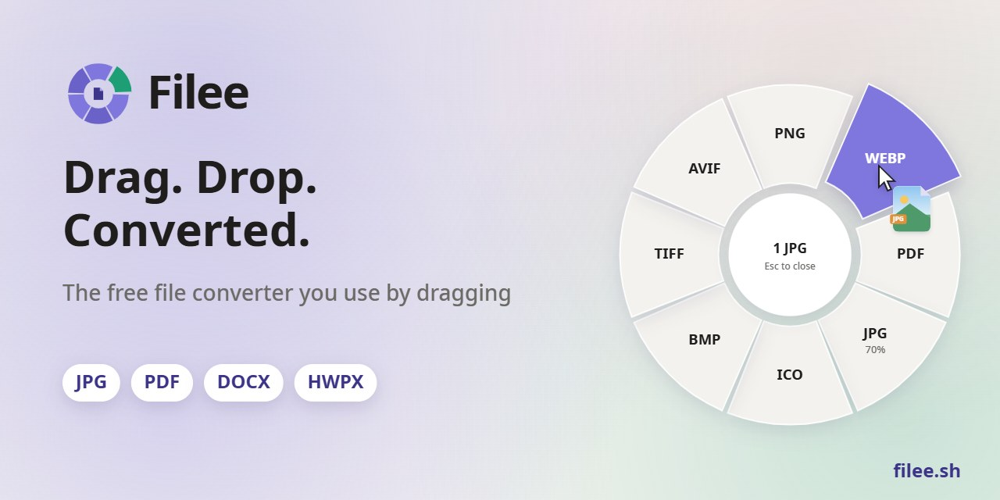
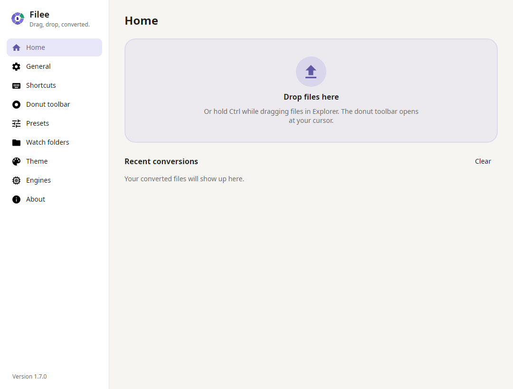

<p align="center">
  <a href="https://github.com/winbulid/TangerineConvert"></a>
</p>

<p align="center">
  <b>用拖放操作的免費、開放原始碼的檔案格式轉換器。</b><br>
  按住一個鍵（<kbd>Ctrl</kbd>，macOS 為 <kbd>Option</kbd>）拖曳檔案，游標處會彈出格式圓環，放到想要的格式上即可。
</p>

<p align="center">
  <a href="https://github.com/winbulid/TangerineConvert"><b>官網</b></a> ·
  <a href="https://github.com/winbulid/TangerineConvert/releases/latest"><b>下載</b></a> ·
  <a href="#安裝">安裝</a> ·
  <a href="#命令列">命令列</a> ·
  <a href="#開發">開發</a>
</p>

<p align="center">
  <a href="https://github.com/winbulid/TangerineConvert/releases/latest"></a>
  <a href="https://github.com/winbulid/TangerineConvert/releases"></a>
  
  
  
  <a href="LICENSE"></a>
</p>

<p align="center">
</p>

<p align="center">
  <a href="README.md">English</a> ·
  <a href="README.es.md">Español</a> ·
  <a href="README.ja.md">日本語</a> ·
  <a href="README.ko.md">한국어</a> ·
  <a href="README.zh-CN.md">简体中文</a> ·
  <b>繁體中文</b> ·
  <a href="README.pl.md">Polski</a> ·
  <a href="README.hi.md">हिन्दी</a> ·
  <a href="README.ru.md">Русский</a> ·
  <a href="README.ar.md">العربية</a> ·
  <a href="README.pt-BR.md">Português (Brasil)</a> ·
  <a href="README.pt-PT.md">Português (Portugal)</a> ·
  <a href="README.fr.md">Français</a> ·
  <a href="README.th.md">ไทย</a> ·
  <a href="README.tr.md">Türkçe</a>
</p>

<table>
  <tr>
    <td width="33%" valign="top">
      <b>就在游標旁</b><br>
      無需開啟應用程式視窗。
      只顯示適合當前拖曳檔案的格式，就在你所在的位置。
    </td>
    <td width="33%" valign="top">
      <b>270 種格式，無需其他軟體</b><br>
      圖片、PDF、Word、Excel、PowerPoint、HWP、電子書、壓縮檔、字型、CAD、3D 模型和地理資訊資料，無需 Office、韓文文書軟體或 LibreOffice。
    </td>
    <td width="33%" valign="top">
      <b>只在你的電腦上</b><br>
      不上傳任何檔案。
      Tangerine 離線工作，結果儲存在原始檔案旁邊。
    </td>
  </tr>
</table>

## 實際效果

<p align="center">
  <a href="https://github.com/winbulid/TangerineConvert"></a><br>
  <sub>27 秒影片和互動式示範請前往 <a href="https://github.com/winbulid/TangerineConvert">github.com/winbulid/TangerineConvert</a></sub>
</p>

## 安裝

從 [Releases](https://github.com/winbulid/TangerineConvert/releases/latest) 下載。

<a href="https://apps.microsoft.com/detail/XPDCN05L89WS0C?referrer=appbadge&cid=github&mode=full"></a>

- **Windows 10/11** 執行 `Tangerine-<version>-win-Setup.exe`，或解壓縮 `win-Portable.zip` 後執行 `Tangerine.exe`。
  - 安裝程式是 Tangerine 自己的，使用與 Tangerine 相同的語言，電腦上無需另外安裝任何元件。
  - 安裝時可以新增檔案總管選單、登入時啟動、`tangerine` 命令和可選引擎。
  - 靜默安裝沿用 Inno Setup 的參數（`/VERYSILENT /SUPPRESSMSGBOXES`）。
- **macOS 13 及以上**（預覽）解壓縮 `osx-arm64` 或 `osx-x64` 壓縮檔並執行 `./install.sh`。
  - 也可以打開 `.dmg`，把 Tangerine 拖到「應用程式」檔案夾（`tangerine` 指令只由 `install.sh` 加入）。
  - 目前尚未公證，首次啟動時請在系統設定 → 隱私權與安全性中按一下 **仍要打開**。
- **Linux x64、ARM64**（Ubuntu 22.04 及以上）解壓縮後執行 `./install.sh`（無需 root，需要 Python 3）。
  - 拖曳手勢需要 X11，Wayland 下請使用拖放區域和檔案管理員的右鍵選單。

有新版本時 Tangerine 會在選單中提示，更新時保留設定和引擎。
更新後會用幾張投影片介紹新功能。

**Windows：Tangerine 無法啟動（沒有視窗也沒有錯誤訊息）？**
這種情況發生在長期未更新的 Windows 10 上，且電腦的處理器支援「硬體強制堆疊保護」（CET）。
Windows 會開啟這項保護，卻缺少 .NET 需要的一項功能，因此 Tangerine 和安裝程式會立即結束。

- **建議**：安裝 Windows Update 中可用的更新（最新的累積更新）。
- **無法更新時**：通常只對 Tangerine 關閉這項保護就能啟動。
  以系統管理員身分開啟 PowerShell 並執行：

```powershell
Set-ProcessMitigation -Name Tangerine.exe -Disable UserShadowStack
Set-ProcessMitigation -Name tangerine-cli.exe -Disable UserShadowStack
```

安裝程式也執行同樣的命令，換成它的檔名（例如 `Tangerine-<version>-win-Setup.exe`）；使用可攜版 ZIP 則只需上面兩行。
要復原，請到「Windows 安全性 → 應用程式與瀏覽器控制 → 惡意探索保護設定 → 程式設定」刪除這些項目。

## 功能

- **游標旁的圓環**，按住按鍵拖曳檔案，放到格式上即可。
  只顯示適合這些檔案的格式。
- **直接從瀏覽器拖**，Chrome、Edge、Firefox 或 Safari 裡的圖片、檔案連結和下載項目也能這樣拖放。
  - Tangerine 會儲存到「下載」資料夾（也可以只保留轉換後的檔案）再轉換。
  - 連結下載時不使用瀏覽器的登入資訊。
- **每種檔案類型一個工具列**，拖放排列。
  以下都能用預設設定：
  - 品質、尺寸、DPI
  - PDF 頁面和壓縮
  - 影片音訊
  - 儲存位置和檔名
- **圓環有背面**，圓環開啟時按 <kbd>Tab</kbd> 或轉動滑鼠滾輪翻過來，背面是不常用的格式和工具。
- **轉換前先裁剪**，「裁剪」會逐張開啟圖片。
  拖曳選框、選擇比例，只儲存選取的部分。
- **一次轉換多個檔案**，平行處理。
  需要多步的轉換（HWP → HWPX → DOCX）會自動找到路線。
- **監視資料夾**，放入的檔案自動轉換。
- **最近的轉換**顯示在首頁上，每項都有縮圖，可以直接「開啟檔案」，也可以用「開啟方式」換個應用程式開啟。
- **其他方式** 右鍵選單、鍵盤快速鍵、拖放區域和 [`tangerine` 命令](#命令列)。
- 淺色和深色主題，可自選強調色和環形工具列不透明度，支援 English、Español、日本語、한국어、简体中文、繁體中文、Polski、हिन्दी、Русский、العربية（從右到左）、Português (Brasil)、Français、नेपाली、ไทย、Türkçe、Português (Portugal)、Deutsch、Italiano。

## 截圖

<table>
  <tr>
    <td width="50%"></td>
    <td width="50%"></td>
  </tr>
  <tr>
    <td align="center"><sub>拖放排列圓環，每種檔案類型一個設定檔</sub></td>
    <td align="center"><sub>首頁上的拖放區和最近轉換記錄</sub></td>
  </tr>
</table>

## 支援格式

| 來源格式 | 目標格式 |
|---|---|
| **圖片** JPG、PNG、WEBP、AVIF、TIFF、BMP、GIF、APNG、ICO、ICNS、JPEG XL、JPEG 2000、PSD/PSB、TGA、PPM、HEIC、QOI、DDS、PCX、MNG、CUR 等，<br>GIMP XCF、相機 RAW（CR2、CR3、NEF、ARW、DNG 等）、DICOM、OpenEXR、HDR、FITS、JPEG XR（Windows）、iPhone 原況照片（LIVP）僅讀取 | 上述格式互轉（HEIC⁵）、PDF、SVG（描摹）、縮放、灰階，<br>原況/動態相片（iPhone、Android）→ 其中的影片（MP4、MOV⁵），以及影片 → 原況照片（iPhone）或動態相片（Android）⁵（實驗功能） |
| **向量圖** SVG、SVGZ、EMF、WMF、AI<br>EPS、PS¹<br>CDR、VSD、CGM、ODG、FODG² | PDF（向量）、PNG 等圖片、<br>SVG ↔ SVGZ、SVG → DXF/DWG、PDF → EPS/PS¹、SVG → EMF、WMF、ODG² |
| **PDF** | DOCX、HWPX、TXT、PNG、JPG、TIFF、CBZ、PPTX（每頁一張圖片）、SVG²，<br>合併（先選擇順序）、拆分、頁碼範圍、壓縮（更小的 PDF） |
| **文件** DOCX、DOCM、DOTX、EML、Outlook MSG，<br>OFD（電子發票、公文）僅讀取<br>DOC、ODT、FODT、OTT、RTF、WPS、WPD、Pages、ClarisWorks、MacWrite、T602 等² | PDF、DOCX、HWPX、EPUB、TXT、HTML、<br>MSG → EML<br>ODT、FODT、OTT² |
| **試算表** XLSX、XLSM、XLS、XLT、ODS、CSV、TSV<br>OTS、FODS、Numbers、ET² | PDF、XLSX、ODS、CSV、TSV、JSON、HWPX、HTML<br>XLT、OTS² |
| **簡報** PPTX、PPTM、POTX、POTM、PPSX<br>PPT、ODP、OTP、FODP、Keynote² | PDF、PNG、JPG、DOCX、HWPX<br>OTP² |
| **HWP** HWP、HWPX | PDF、PNG、DOCX、HWPX ↔ HWP、TXT、Markdown、HTML |
| **文字** TXT、LOG、指令碼原始碼（PY、PAC、BAT、COMMAND，只讀取，從不執行）、Markdown、HTML，<br>MHTML（儲存的網頁）僅讀取<br>reStructuredText、LaTeX、Org、AsciiDoc、Typst、MediaWiki、DocBook、Jupyter、Textile、man、OPML³ | UTF-8 TXT、PDF、DOCX、HWPX、EPUB<br>互相轉換、PPTX 投影片³ |
| **電子書** EPUB、KEPUB、MOBI、AZW3、AZW、AZW4、FB2、CBZ、CBR、CB7、HTMLZ、TXTZ<br>LIT、LRF、CHM、PDB 等⁴ | PDF、EPUB、KEPUB（Kobo）、DOCX、TXT、HTML、HWPX<br>MOBI、AZW3⁴ |
| **影片**⁵ MP4、MOV、MKV、WEBM、AVI、WMV、FLV、MPEG、VCD（DAT）、TS、M2TS、3GP、OGV、VOB 等 | MP4（H.264、HEVC、AV1）、WEBM、MOV、MKV、AVI、GIF、APNG、MP3、M4A、720p、<br>字幕（SRT、ASS、WebVTT） |
| **音訊**⁵ MP3、M4A、AAC、WAV、FLAC、OGG、OPUS、WMA、AIFF、AMR、APE、WavPack、TTA、DSD（DSF、DFF）、DTS、AC3、E-AC3 等 | MP3、M4A（AAC、ALAC）、WAV、FLAC、OGG、OPUS、AAC、WavPack、TTA、W64、AC3、E-AC3 |
| **字幕** SRT、ASS/SSA、WebVTT、SAMI（SMI）、LRC、TTML、MicroDVD、SCC | 互相轉換，儲存為 UTF-8（也能讀取 CP949 韓文字幕） |
| **壓縮檔** ZIP、ANSYS Workbench（WBPZ）、7Z、RAR、TAR、TAR.GZ、TAR.BZ2、TAR.XZ、GZ、ISO、CAB、DMG、ALZ、EGG 等 | 解壓縮、ZIP、7Z、TAR、TAR.GZ，<br>多個檔案 → 一個 ZIP |
| **CAD** DWG、DXF | PDF、SVG、PNG、DWG ↔ DXF |
| **字型**：TTF、OTF、WOFF、WOFF2、EOT；<br>FON（Windows 點陣字型）僅讀取 | 相互轉換；<br>FON → 每個尺寸一個檔案 |
| **資料** JSON、JSON Lines、YAML、TOML、XML<br>vCard、iCalendar | 互相轉換、CSV 和 XLSX（表格資料）、<br>vCard、iCalendar ↔ CSV |
| **3D 模型** GLB、glTF、STL、OBJ（+ MTL）、3MF、PLY，<br>FBX 僅讀取 | 互相轉換、PNG 預覽 |
| **地理資訊（向量）** Shapefile、GeoJSON、KML、KMZ、GPX<br>帶座標的 CSV，<br>Garmin FIT 僅讀取 | 互相轉換、CSV / XLSX / JSON，<br>投影座標系統（UTM、Web 麥卡托、蘭伯特、阿爾伯斯）會轉換為 WGS 84 經緯度 |

未標註的格式裝好即用，無需 Office、韓文文書軟體或 LibreOffice。

## 命令列

`tangerine` 命令使用與應用程式相同的引擎和預設（安裝程式或 `install.sh` 會新增它）。

```
tangerine convert photo.heic --to jpg
tangerine convert *.png --to webp --quality 80 -o converted
tangerine watch D:\Inbox --to pdf --move-originals
```

全部命令和選項見 [github.com/winbulid/TangerineConvert](https://github.com/winbulid/TangerineConvert/) 或 `tangerine help`。

## 開發

在 Windows、macOS 或 Linux 上使用 .NET 10 SDK 建置。

```bash
git clone https://github.com/winbulid/TangerineConvert.git
cd Tangerine
pwsh build/fetch-engines.ps1 -Only rhwp,pandoc   # optional engines
dotnet run --project src/Tangerine.App
dotnet test
```


歡迎提交 Pull Request。

## 程式碼簽章政策


  - 2.0.0 及更早的版本沒有簽署。

詳細政策和隱私權政策見[英文 README](README.md#code-signing-policy)。
Tangerine 不會上傳檔案，也不會傳送任何使用資料。

## 贊助

Tangerine 免費，並將一直免費。
謝謝！

**你的名字或標誌可以出現在這裡。**
按月贊助者的名字會列在這裡，標誌檔位的標誌會顯示在這裡和 Tangerine 的「關於」頁面。
一次性贊助的朋友也可以要求列出名字。


## 授權條款

隨附的第三方元件遵循各自的授權條款，詳見 [THIRD-PARTY-NOTICES.md](THIRD-PARTY-NOTICES.md)。

<p align="center">
  <a href="https://star-history.com/#winbulid/TangerineConvert&Date"></a>
</p>
